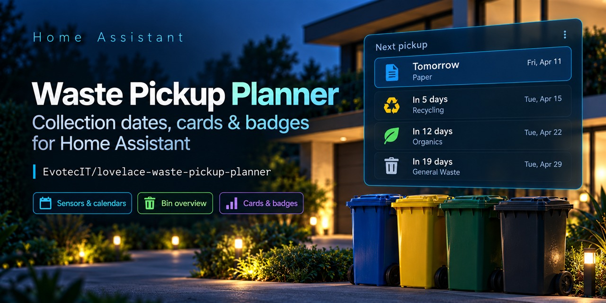
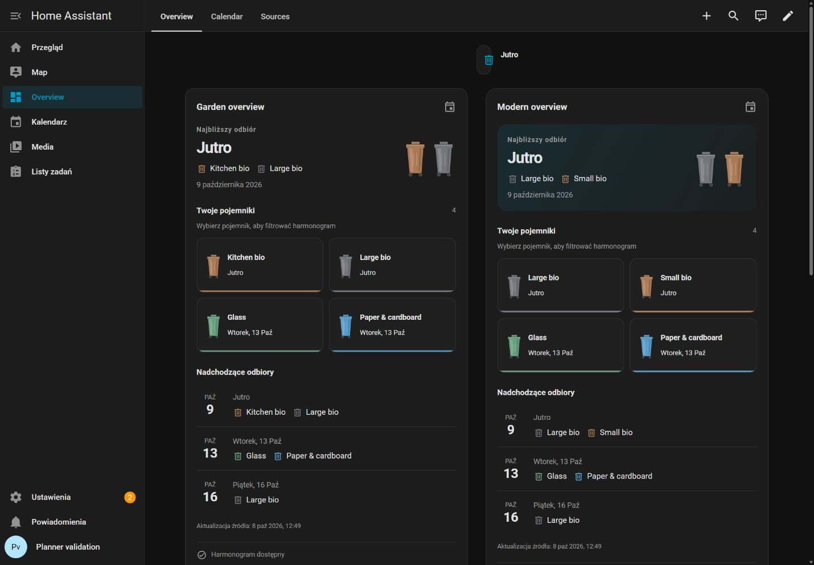
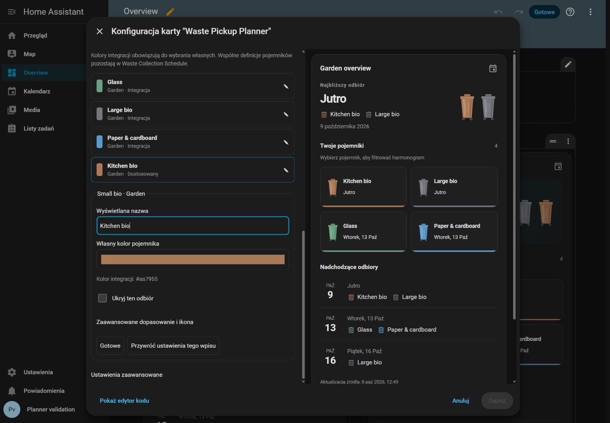
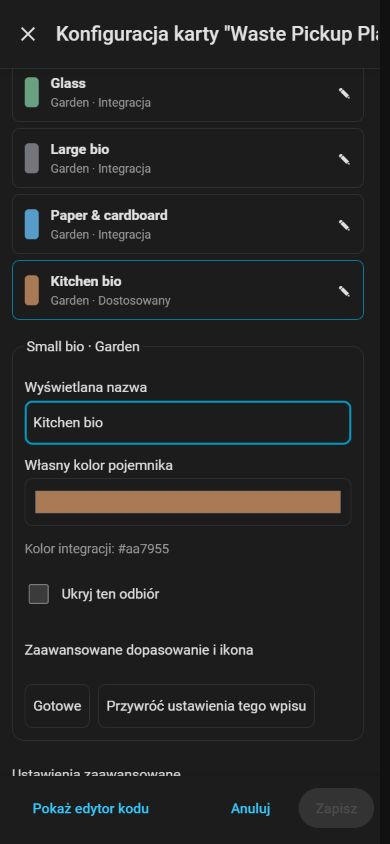

# Waste Pickup Planner for Home Assistant



[](https://my.home-assistant.io/redirect/marketplace_repository/?owner=EvotecIT&repository=lovelace-waste-pickup-planner&category=plugin)
[](https://github.com/EvotecIT/lovelace-waste-pickup-planner/actions/workflows/validate.yml)
[](LICENSE)
[](https://github.com/EvotecIT/lovelace-waste-pickup-planner/stargazers)


Never miss bin day. See which bins go out next, color-coded and grouped by
date, right on your Home Assistant dashboard.



*The real card in Home Assistant. The banner above is artwork.*

## What you get

- **Every bin at a glance:** the next pickup, each bin's next date, and a
  schedule you can filter by bin.
- **Pick the size that fits:** a full overview, a compact card, a hero with bin
  illustrations, a plain schedule list, a wall-tablet view, or a small dashboard badge.
- **Your bins, your colors:** use the colors from your waste integration, or pick
  your own per bin in the visual editor.
- **Uses what you already have:** reads your
  [Waste Collection Schedule](https://github.com/mampfes/hacs_waste_collection_schedule)
  sensor or any Home Assistant calendar. No extra account, and nothing is sent
  to your council.
- **Set up in the visual editor.** YAML is optional.

Requires **Home Assistant 2026.9.1 or newer**.

## Installation

### Home Assistant 2026.11 and newer

[](https://my.home-assistant.io/redirect/marketplace_repository/?owner=EvotecIT&repository=lovelace-waste-pickup-planner&category=plugin)

1. Open **Settings → Marketplace** and search for **Waste Pickup Planner**.
2. Open the project and select **Install**.
3. Reload your browser, then add **Waste Pickup Planner** to your dashboard.

If the project is missing from your catalog, choose **Add from link** and enter
`https://github.com/EvotecIT/lovelace-waste-pickup-planner`. Adding a custom repository
requires a GitHub connection.

The Marketplace registers the dashboard resource automatically. If you manage
resources manually, use `/local/community/lovelace-waste-pickup-planner/waste-pickup-planner-card.js`
as a JavaScript module. Existing `/hacsfiles/` URLs continue to work.

Existing HACS installations migrate automatically when Home Assistant upgrades
to 2026.11. The repository metadata remains in `hacs.json`.

### Home Assistant 2026.10 and older: HACS

1. Open **HACS** in Home Assistant and search for **Waste Pickup Planner**.
   If it is missing, add `https://github.com/EvotecIT/lovelace-waste-pickup-planner`
   in **Custom repositories**, with type **Dashboard**.
2. Open its details and select **Download**.
3. Reload your browser after installation.

To install a preview release, select **Download** or **Redownload**, choose **Need a different version?**, and select the preview release.

HACS installs the resource at:

```yaml
url: /hacsfiles/lovelace-waste-pickup-planner/waste-pickup-planner-card.js
type: module
```

### Manual installation

Download `waste-pickup-planner-card.js` from [Releases](https://github.com/EvotecIT/lovelace-waste-pickup-planner/releases), copy it to `config/www/waste-pickup-planner-card.js`, and add `/local/waste-pickup-planner-card.js` as a JavaScript module in **Settings → Dashboards → Resources**. One file registers both the card and badge. No additional artwork files are required.

## First dashboard setup

1. Have a [supported sensor or calendar](#choose-a-source) ready. Install and
   configure its data integration separately; this card displays existing HA data.
2. Open a dashboard and choose **Edit dashboard → Add card**. Search for
   **Waste Pickup Planner**.
3. Select the source, choose a layout, and save. Start with one source so the
   first displayed collection is easy to compare with its sensor or calendar.
4. To add a badge, use the dashboard's **Add badge** picker and choose
   **Waste Pickup Planner Badge**, then select the same source and save.

Both components have visual editors; YAML is optional. If no supported source
appears, follow the source setup below before adding more entities.

## Choose a source

For [Waste Collection Schedule](https://github.com/mampfes/hacs_waste_collection_schedule), select a sensor with **Generic** details. This exposes structured `upcoming` records. Its usual date-keyed details mode is intended for native entity displays and does not supply the structured records this card uses.

Choose the combined sensor to display all bins for an address. In the integration's visual bin controls, Generic is labeled **All attributes**. The card editor suggests structured sensors and calendars; a saved sensor with another details format shows instructions for changing it.

Alternatively, select a Home Assistant calendar:

```yaml
type: custom:waste-pickup-planner-card
entity: calendar.waste_collection
layout: compact
```

A calendar only gives a name and date for each pickup, so its bins stay neutral. When a structured Waste Collection Schedule sensor belongs to the calendar's device, or to a sensor device linked to it, the editor offers to use that sensor instead.

Use one authoritative source for each address. Multiple explicit sources are supported through `entities`, but the card does not infer which sensors or calendars represent the same address. Selecting both a combined sensor and its calendar can show both representations. Separate selected sources retain their identity even when dates and names match.

## Layouts

```yaml
type: custom:waste-pickup-planner-card
entity: sensor.waste_schedule
layout: hero
show_artwork: true
days_to_show: 30
max_groups: 4
```

- **Compact** shows the next date, up to six collection names, and a count of any additional collections.
- **Hero** adds optional bin artwork and upcoming date groups.
- **Schedule** shows date-grouped rows.
- **Overview** shows the next pickup, each supplied bin's next date, a filterable schedule, and source status. Select a bin to filter the upcoming list and schedule dialog; select it again or choose **Show all bins** to clear the filter. Bin lists longer than 12 entries have page controls.
- **Wall tablet** is for a tablet on the wall, read from across the room: the day in large type ("Put out tonight" from the evening before), each bin of the next pickup as a large tile in its own colour, and the next few pickups below. It scales with the card's width; give it the full width of a panel or a wide column.
- **Badge** shows the next date and collection names or a count. Its accessible description includes up to six complete names; the default action opens all collections. Add it to a view's badges:

```yaml
type: custom:waste-pickup-planner-badge
entity: sensor.waste_schedule
```

Visible date groups show up to six complete collection names and an overflow count. The default action opens the full schedule for the configured date range, in pages of 100 collections. The dialog supports keyboard navigation and Escape to close. English and Polish interface labels are included; dates follow Home Assistant's language and home timezone.

For an overview with a tinted header and tighter spacing:

```yaml
type: custom:waste-pickup-planner-card
entity: sensor.waste_schedule
layout: overview
appearance: modern
density: compact
```

**Native Home Assistant**, **Modern**, and **Minimal** appearance presets use the active HA theme. Comfortable spacing is the default. These options change presentation; provider and local bin colors retain their existing meaning. The overview shows bins present in the supplied date range, rather than inferring a complete physical-bin inventory. Identical labels from different selected sources remain separate. Source names appear on tiles by default when multiple sources are selected.

## Configuration

Both components have visual editors. Advanced YAML uses the same options:

| Option | Default | Purpose |
| --- | --- | --- |
| `entity` | Required unless `entities` is set | Sensor or calendar ID |
| `entities` | — | Up to 12 explicit sources; do not also set `entity` |
| `title` | No heading | Card heading; the card shows a heading row only when you set one. The schedule dialog and badge use the localized “Waste collection” when it isn't set |
| `layout` | `compact` | `compact`, `hero`, `schedule`, `overview`, or `wall` |
| `appearance` | `native` | `native`, `modern`, or `minimal`; card presentation |
| `density` | `comfortable` | `comfortable` or `compact`; card spacing |
| `show_source` | Multiple sources | Source names on overview bin tiles |
| `days_to_show` | `30` | Range beginning today in the home timezone, 1–366 days |
| `max_groups` | `5` | Visible date groups, 1–50; details show the full range |
| `show_artwork` | `true` in overview; `false` otherwise | Decorative bins in hero and overview |
| `show_updated` | `false` | Display the sensor's provider-backed `last_update` attribute when present |
| `show_manage_bins` | `false` | Card shortcut to the Waste Collection Schedule integration page |
| `evening_hour` | `18` | Home-clock hour (0–23) from which the card says “Put out tonight” for tomorrow's bins, and the badge does too |
| `show_strip` | `true` in hero and overview; `false` otherwise | A strip of the next 14 days with a dot per bin in its colour, so the collection rhythm shows at a glance |
| `locale` | HA language | Optional language code such as `pl` or `en-GB` |
| `overrides` | — | Exact collection names/IDs, display names, icons, colors, visibility |
| `tap_action.action` | `details` | `details`, `more-info`, `navigate`, or `none`; in `compact`, `hero`, `schedule` and `wall`, tapping anywhere on the card runs it, and `overview` keeps a button because its bin tiles are buttons too |
| `tap_action.navigation_path` | — | Local dashboard path for `navigate` |

`layout`, `max_groups`, `show_artwork`, `show_manage_bins`, `appearance`, `density`, and `show_source` do not change the badge presentation. `more-info` opens the first selected entity. Overview source buttons open the corresponding entity's native details.

### Visual bin colors

The visual editor starts with **Source and layout**, followed by **Appearance** and **Bins**. Select a bin to open its editing panel, then pick a local color, change its display name, or hide it. Only one panel opens at a time. **Use integration color** removes the local color override; **Reset this override** removes that bin's local settings. Category matching, icons, date-range settings and tap actions stay under **Advanced settings**. The editor follows HA's English or Polish language setting.

Settings affect this card or badge; manage bin definitions and shared colors in Waste Collection Schedule. Enable **Show Manage bins shortcut** on a card to open that integration's native management page.



<details>
<summary>Bin controls on mobile</summary>



</details>

Bins with different names remain separate when they share a canonical category and collection date, including when local display names match. A visual override records the selected source entity and complete original bin name. If you rename that bin in the integration, reselect it in the card editor. Calendar bins also appear in the ordinary visual list after their events load; discovery uses the configured date range. For bins absent from the supplied records, use **Advanced settings → Add a category or missing bin override**.

```yaml
type: custom:waste-pickup-planner-card
entity: sensor.waste_schedule
layout: hero
show_artwork: true
overrides:
  - type: bio
    name: Food and garden
    color: '#9A6C45'
    icon: mdi:leaf
  - type: Payment reminder
    hidden: true
```

`type` matches a v3 `type_id`, or the complete collection label when no ID exists. Names containing commas remain a single label. Colors must use `#RRGGBB`; icons must use `mdi:…`.

Optional `source` and `label` restrict an override to one source and its exact bin name. For example, two bio bins can keep separate local colors:

```yaml
overrides:
  - type: organic
    source: sensor.waste_schedule
    label: Small bio
    color: '#123456'
```

Specific bin settings take precedence over broader category settings, per field. Within the same scope, the first matching override wins. A local card color takes precedence over the integration's effective color; removing it inherits the broader card override, if present, otherwise the integration color. The integration owns provider and shared category defaults.

Bin artwork uses provider/customized color metadata or an explicit override. Category-default colors may color an icon, but never claim the color of your physical bin. Calendar-only sources have neutral bins unless you configure overrides.

## Themes and unavailable sources

Cards inherit Home Assistant's card background, text, divider, radius, shadow, and primary-color variables. Light, dark, and custom themes need no separate configuration.

An empty date range is distinct from an unavailable source. If a source fails after loading, the card keeps its last schedule in memory and labels it as potentially out of date. Reloading the page clears that cache. A state-change timestamp is never presented as a provider refresh time.

Calendar reads are shared across instances on the same HA connection while pending and for one minute after completion. Detached components stop publishing results and remove their timers/listeners; requests already issued through HA's `callApi` may finish in the background.

## Native Home Assistant alternatives

Existing sensors also work without this frontend. For a built-in [entity badge](https://www.home-assistant.io/dashboards/badges/):

```yaml
type: entity
entity: sensor.next_waste_pickup
name: Waste
show_name: true
show_state: true
tap_action:
  action: more-info
```

For a native Tile or Entities card:

```yaml
type: tile
entity: sensor.next_waste_pickup
name: Next collection
```

```yaml
type: entities
entities:
  - sensor.next_waste_pickup
  - sensor.bio
```

Native cards display the sensor's own state. They do not gain this card's grouping or color logic.

## Documentation

| I want to… | Guide |
| --- | --- |
| Add my first card or badge | [First dashboard setup](#first-dashboard-setup) |
| Choose a sensor or calendar | [Source setup](#choose-a-source) |
| Choose a layout or look up an option | [Layouts](#layouts) · [Configuration](#configuration) |
| Check accepted source data and compatibility | [Data and API reference](docs/design-and-api.md) |
| Check validation and remaining quality work | [Quality qualification](docs/quality.md) |
| Build or contribute | [Development](#development) |

## Removal

1. Remove Waste Pickup Planner cards and badges from dashboards that use them.
2. Uninstall the project through **Settings → Marketplace** on HA 2026.11 or
   newer, or through HACS on older HA versions. For a manual installation,
   remove its resource declaration and `config/www/waste-pickup-planner-card.js`.
3. Check **Edit dashboard → Manage resources** for an obsolete resource entry.
   YAML-mode resources must be removed where they were declared. Close and
   reopen Home Assistant browser tabs and app windows to unload the module.

The single JavaScript resource registers both the card and badge. Removing it
leaves the source integration, sensors, calendars, and collection data in place.

## Support

[Report an issue](https://github.com/EvotecIT/lovelace-waste-pickup-planner/issues)
with the card version, Home Assistant version, browser, selected source type,
layout, and steps to reproduce. Include a minimal configuration and a sanitized
example of the source data when relevant. Remove private addresses, calendar
content, entity names, and URLs before posting.

## Development

Use Node.js 24:

```sh
npm ci
npm test
npm run check
npm run pack
npm run preview
```

The standalone preview runs at `http://127.0.0.1:4174` with synthetic data, theme switching, and empty/stale/unavailable states. Home Assistant supplies the actual host components in production.

`src/` separates input adapters, calendar-date calculations, shared projection/controller, rendering, and visual editors. `tests/` covers the sensor/calendar contracts and lifecycle behavior. The one-file build uses Lit and esbuild. Releases use the same shared PowerForge Home Assistant workflow as [Lawn Mower Card](https://github.com/EvotecIT/lovelace-lawn-mower-card).

See [architecture and compatibility](docs/design-and-api.md) for the tested data boundaries, and [quality qualification](docs/quality.md) for acceptance criteria, reproducible checks, and remaining evidence gaps. Concept images in `docs/design/` are design references, not application screenshots.

MIT license.

## Sponsor

Support development and maintenance through
[GitHub Sponsors](https://github.com/sponsors/PrzemyslawKlys).
Sponsorship is optional; these projects remain open source.

## More for your Home Assistant home

Other integrations and dashboards we maintain:

- [Dreame & MOVA mowers](https://github.com/EvotecIT/homeassistant-dreamelawnmower) — Mowing controls, maps, schedules, and supported cameras.
- [Lawn Mower Card](https://github.com/EvotecIT/lovelace-lawn-mower-card) — A dashboard for mower state, maps, and controls.
- [KEF](https://github.com/EvotecIT/homeassistant-kef) — Local control for modern and legacy speaker families.
- [Devialet](https://github.com/EvotecIT/homeassistant-devialet) — Local speaker control, with Dione support.
- [Siegenia](https://github.com/EvotecIT/homeassistant-siegenia) — Local control for supported window controllers.
- [EasyControlX](https://github.com/EvotecIT/homeassistant-easycontrolx) — Connect supported Windows and macOS hosts.

For a native app connected to the same Home Assistant setup:

- [CasaRay](https://casaray.dev/) — rooms, devices, cameras, and home activity on
  iPhone, iPad, and Mac.
- [Tactra Remote](https://tactra.dev/) — media players, speakers, and TV controls
  on iPhone, iPad, Apple Watch, and Mac.

Neither app is required to use this project.
